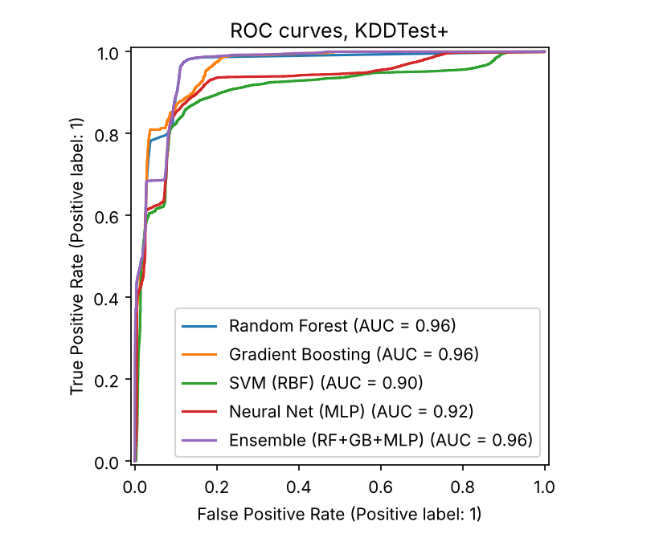
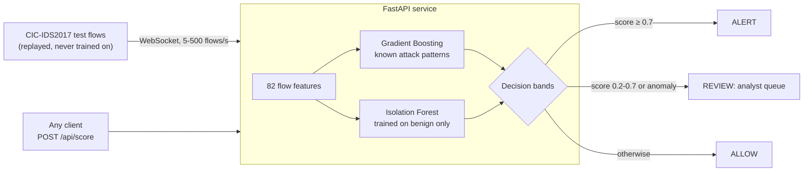

# AI-Assisted Intrusion Detection + ISO/IEC 27001 Risk Assessment

[](https://github.com/shakthihs07-shs/ai-ids-iso27001/actions/workflows/ci.yml) [](LICENSE)

**[Live IDS console](https://shakthihs07-shs.github.io/ids-demo/live/)**: watch the detector score network flows in real time, in your browser.<br>
**[Live attack tracker](https://shakthihs07-shs.github.io/ids-demo/tracker/)**: real attacks on an internet-facing honeypot, as they happen, mapped to MITRE ATT&CK ([`honeypot/`](honeypot/README.md)).<br>
**[Results dashboard](https://shakthihs07-shs.github.io/ids-demo/)**: results for both datasets, MITRE coverage and the risk register on one page, read straight from `results/`.<br>
**[GRC evidence pack](docs/06_grc_evidence_pack.md)**: ISO/IEC 27001:2022 Statement of Applicability for the live service (all 93 Annex A controls, each with evidence), incident register, GDPR record of processing, EU AI Act classification and model card.

An end-to-end security project: I **built and tested a machine-learning network intrusion detection system** on NSL-KDD, **mapped its detection coverage to MITRE ATT&CK**, **tested AI guardrails** (unknown attacks, drift, evasion, alert thresholds), and wrote an **ISO/IEC 27001:2022 risk assessment and risk register** for deploying it in a SOC. It runs as a **real-time detection service** with a [live SOC console](https://shakthihs07-shs.github.io/ids-demo/live/) (below). The core tests are **repeated on CIC-IDS2017** (labels corrected in 2023) to check that the findings hold on modern traffic.

It follows on from my MSc thesis (*AI-Assisted Intrusion Detection: A Comparative Study of Network Forensics Approaches*, IU Berlin, 2025), a systematic review of 68 studies. The thesis concluded that lab accuracy overstates real performance and that hybrid detection works best. This project tests those claims hands-on.

## Key results

| | Result |
|---|---|
| Best model (Gradient Boosting) | **F1 79.6%**, precision 96.9%, recall 67.6%, false-positive rate 2.8% |
| Lab vs realistic test | **99.9% F1** in cross-validation vs **79.6%** on the test set with 17 unseen attack types |
| Known vs novel attacks (ensemble) | **78.2%** vs **39.5%** detected |
| Hybrid (supervised + anomaly layer) | Novel attacks **65.9%**, overall recall **76.0%**, F1 **85.1%**, FPR 3.3% |
| MITRE ATT&CK coverage | Floods and scans ~100%; **password guessing (T1110.001) 0%** |
| Evasion test | ~**17%** of detected attacks evade after simple traffic padding |
| Risk register | 14 risks: 4 Critical → 0 Critical after treatment; 1 High remains for CISO acceptance |
| **CIC-IDS2017** (8 attack types unseen in training) | Known types **99.99%**, novel types **3.2%** detected; with the anomaly layer **73.6%** at 5.1% FPR |



## Live IDS console (real-time demo)

**[Open the live console](https://shakthihs07-shs.github.io/ids-demo/live/)**. It runs two ways, from one UI (`app/static/index.html`):

- **In your browser** (the public demo, GitHub Pages): the detector is exported to ONNX (`app/export_web.py`) and runs in onnxruntime-web, so there is no server to host. The export stops unless the ONNX models reach the same decision as the Python detector on every replay flow (17,353 of 17,353).
- **As a service**: a FastAPI backend scores flows as they stream over a WebSocket, plus a REST API, in a Docker image.

Both show decisions per half second, an alert feed marked right or wrong against the true label, per-attack detection with MITRE ATT&CK techniques, and an analyst queue.



**What it shows**, on all 1,266,736 test flows (`GET /api/model`):

- Known attack types (DoS, Heartbleed, FTP/SSH brute force): **99.99%** detected, almost all as automatic alerts.
- Attack types never seen in training: **70.9%** detected, all through the anomaly layer into the analyst queue. That rate is mostly port scans (99.96%) and infiltration (91.7%); **DDoS (1.6%), botnet traffic (6.0%) and web brute force (0%) still get through**, which is why a flow-based ML layer belongs next to signatures and rate limits, not in place of them.
- The price: **5.1%** of benign flows go to the analyst queue, the anomaly layer's alert budget.

The replay is real test data, compressed so attacks arrive every few seconds. Run it locally:

```bash
pip install -r requirements.txt
bash data/download_cicids2017.sh      # 328 MB
python -m app.train                   # ~1.5 min, needs ~7 GB RAM: builds app/artifacts/
uvicorn app.main:app --port 7860      # open http://localhost:7860, API docs at /docs
python -m app.export_web              # refresh the in-browser console in live/ (pip install -r requirements-dev.txt)
```

Score your own flows (CICFlowMeter features, names in `GET /api/model`):

```bash
curl -X POST localhost:7860/api/score -H 'content-type: application/json'   -d '{"flows": [{"Flow Duration": 1200, "Protocol": 6, "...": 0}]}'
```

Every push that touches the service builds the Docker image on GitHub Actions and smoke-tests the running container (`deploy/smoke_test.py`): model card, scoring API, input validation and the live stream.

## Repository

```
docs/
  01_threat_model.md              STRIDE + AI-specific threats, data flow
  02_mitre_attack_mapping.md      37 attack types -> ATT&CK techniques, measured coverage
  03_iso27001_risk_assessment.md  Method, risk summary, Annex A / SoA extract, treatment plan,
                                  India vs EU/Germany (NIS2, GDPR, BetrVG, EU AI Act) mapping
  04_findings_report.md           Full results, findings and recommendations
  05_ai_guardrails.md             Hybrid detection, thresholds, human-in-the-loop, drift, evasion
  06_grc_evidence_pack.md         The live service: policy, assets, suppliers, SoA summary, incident
                                  playbook and register, GDPR record, EU AI Act, model card
  07_internal_audit_2026-11.md    First internal audit: clauses 4-10, tested Annex A sample, findings, corrective actions
  08_live_service_risk_assessment.md  12 risks of the live service, scored, decided and traced to SoA controls
risk_register.xlsx / .csv         14 risks with evidence, owners, Annex A controls, residual risk
grc/                              soa.csv / soa.xlsx (93 Annex A controls), risk_register_live.csv (12 risks
                                  of the live service, linked to SoA controls), collect_evidence.sh (read-only
                                  VM evidence), audit_tests.sh (25 internal audit tests run from outside),
                                  check_endpoint.ps1 (admin laptop check), evidence/ (dated snapshots)
honeypot/                         The live honeypot, collector, tracker page and VM setup
SECURITY.md                       How to report a vulnerability
src/
  common.py                       Data loading, preprocessing, attack categories
  train_evaluate.py               4 models + ensemble, metrics, CV, per-family recall, plots
  guardrails.py                   Guardrail tests
  mitre_mapping.py                ATT&CK mapping and per-technique detection
  cicids2017.py                   Same models and anomaly layer on CIC-IDS2017
  build_risk_register.py          Generates the risk register
  build_soa.py                    Builds grc/soa.xlsx from grc/soa.csv
app/                              Real-time service: detector.py (hybrid detector, decision bands),
                                  train.py (builds it from CIC-IDS2017), main.py (FastAPI + WebSocket),
                                  static/ (live SOC console, browser engine), export_web.py (ONNX export)
live/                             The in-browser console as published: ONNX models, replay flows
Dockerfile, deploy/               Container image and its smoke test
results/                          All metrics (CSV/JSON) and figures; results/cicids2017/ for the second dataset
tests/                            pytest: preprocessing, PSI/FPR, risk-register consistency, live service API and stream,
                                  honeypot privacy and hostile input, SoA completeness and evidence
.github/workflows/ci.yml          Runs the tests on every push; manual run can reproduce all results
.github/workflows/container.yml   Builds the Docker image and smoke-tests the running container
.github/workflows/uptime.yml      Checks the demo and the honeypot every 30 minutes, e-mails on failure
```

## Reproduce

```bash
pip install -r requirements.txt
bash data/download.sh                 # NSL-KDD KDDTrain+ / KDDTest+
cd src
python train_evaluate.py              # ~2 min on 2 CPUs
python guardrails.py
python mitre_mapping.py
python build_risk_register.py
cd .. && pip install -r requirements-dev.txt && pytest

# Optional: second dataset (328 MB download, ~8 min, 16 GB RAM)
bash data/download_cicids2017.sh
python src/cicids2017.py
```

## Methods in one paragraph

NSL-KDD (125,973 training / 22,544 test connections, 41 features). One-hot encoding for protocol, service and flag; log transform for heavy-tailed counts; scaling for SVM and MLP; everything fitted on training data only. Models: Random Forest, HistGradientBoosting, RBF SVM (25k-row stratified sample), MLP (128-64), and a soft-voting ensemble. Metrics: precision, recall, F1, false-positive rate and ROC-AUC on KDDTest+, plus 5-fold cross-validation on KDDTrain+. CIC-IDS2017: 82 flow features (IPs, ports, timestamps dropped), signed log transform, trained on 70% of Monday–Wednesday, tested on the rest plus Thursday–Friday. Guardrails: Isolation Forest trained on normal traffic, threshold sweep, three-band human-in-the-loop policy, PSI drift, feature-space evasion test. Risk assessment: ISO/IEC 27005-style likelihood × impact (5×5), acceptance criterion residual ≤ 9, controls from ISO/IEC 27001:2022 Annex A, Indian regulatory context (CERT-In 2022, DPDP Act 2023), with a mapping of the same deployment to EU/German law (NIS2, GDPR, BetrVG, EU AI Act).

## Limitations

NSL-KDD is based on 1998 traffic. The repeat on CIC-IDS2017 gives different absolute numbers but the same patterns; MITRE mapping, drift, evasion and the risk register still use NSL-KDD only. CIC-IDS2017 is a lab network, and its day split mixes new attack types with day-to-day change in benign traffic. The organisation in the risk assessment is hypothetical. The evasion test is a simple perturbation, not a full adversarial attack.

## License

MIT, see [LICENSE](LICENSE). NSL-KDD and CIC-IDS2017 are from the Canadian Institute for Cybersecurity (Sharafaldin, Habibi Lashkari and Ghorbani, ICISSP 2018); the CIC-IDS2017 labels used here were corrected by KU Leuven DistriNet (Engelen, Rimmer and Joosen, WTMC 2021; Liu et al., CNS 2022). The datasets are not redistributed, except a sample of 17,353 CIC-IDS2017 test flows in `live/replay.csv.gz` that the live console replays.

## Author

**Shakthi H S** – MSc Cybersecurity (IU Berlin), CompTIA Security+ · [LinkedIn](https://www.linkedin.com/in/shakthi-hassan-sangameshwara/)
